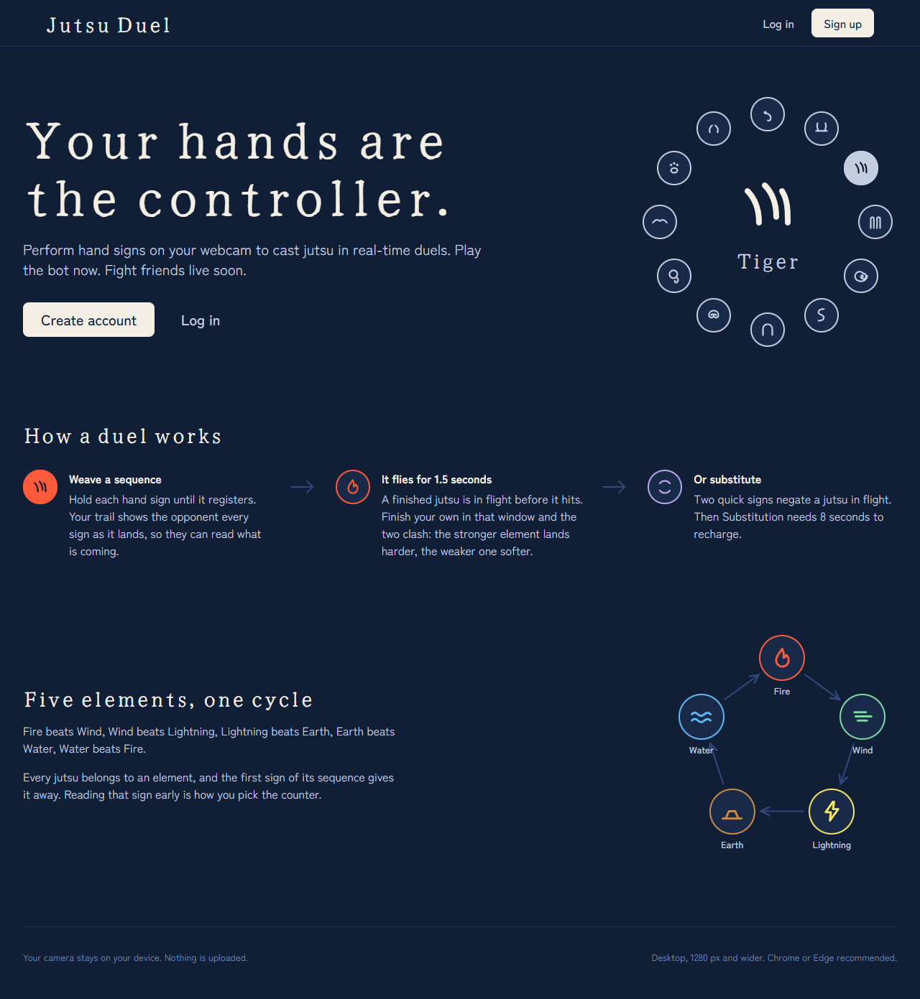
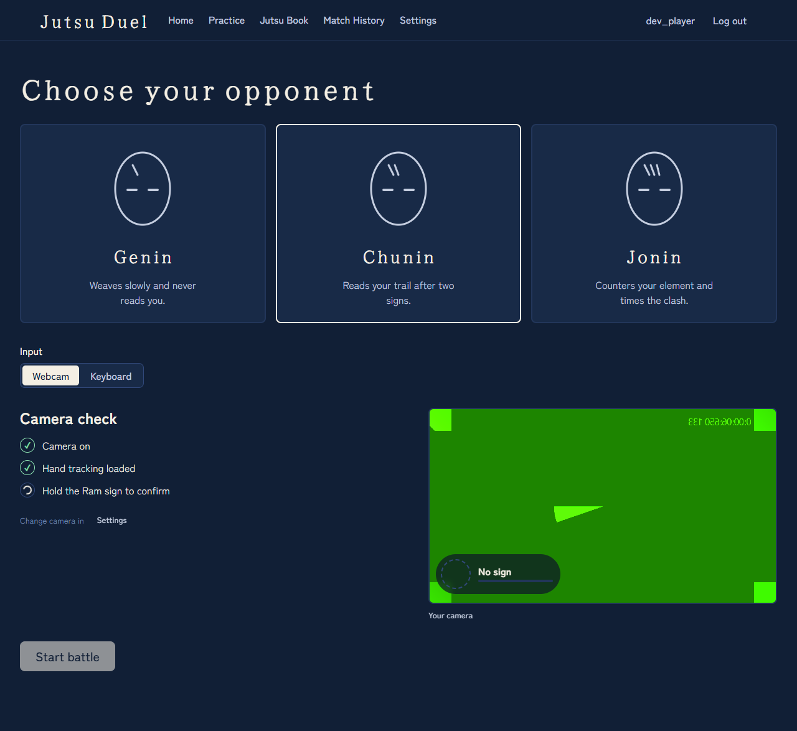
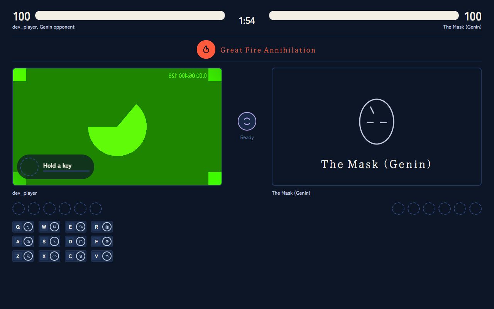
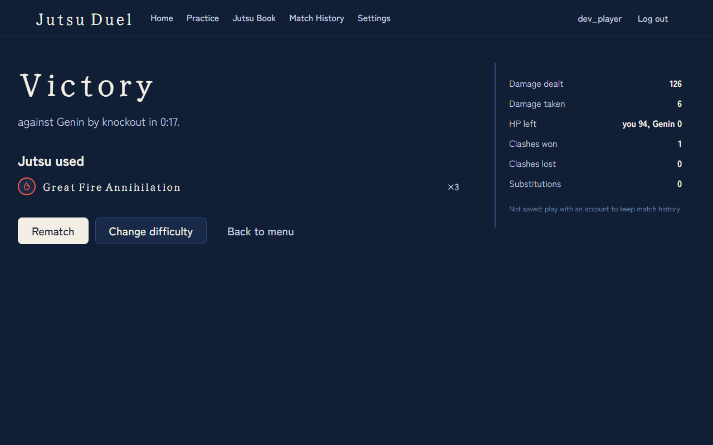
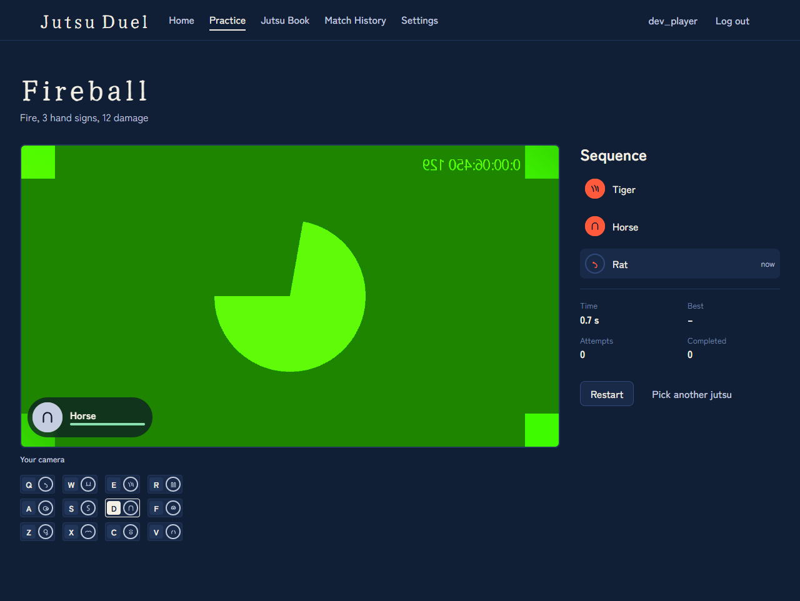
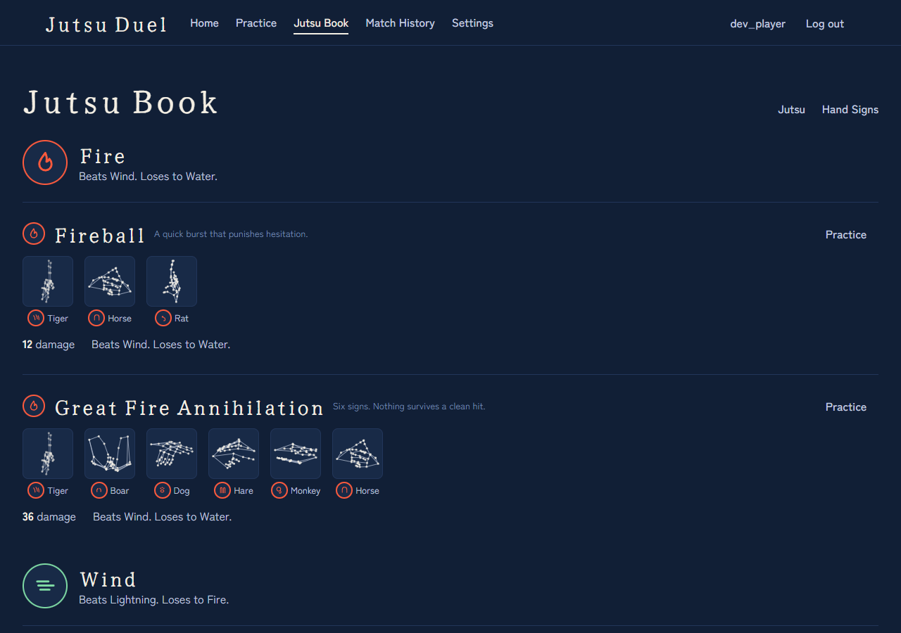
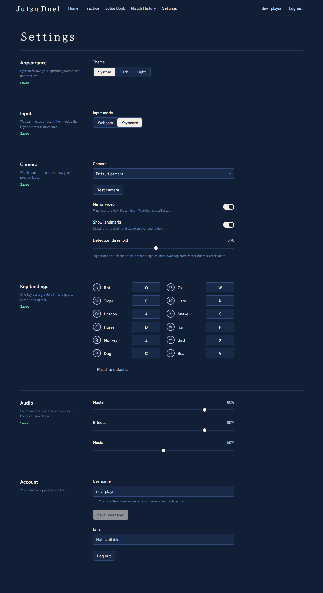
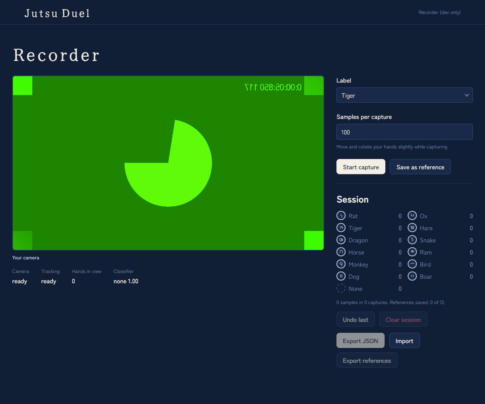
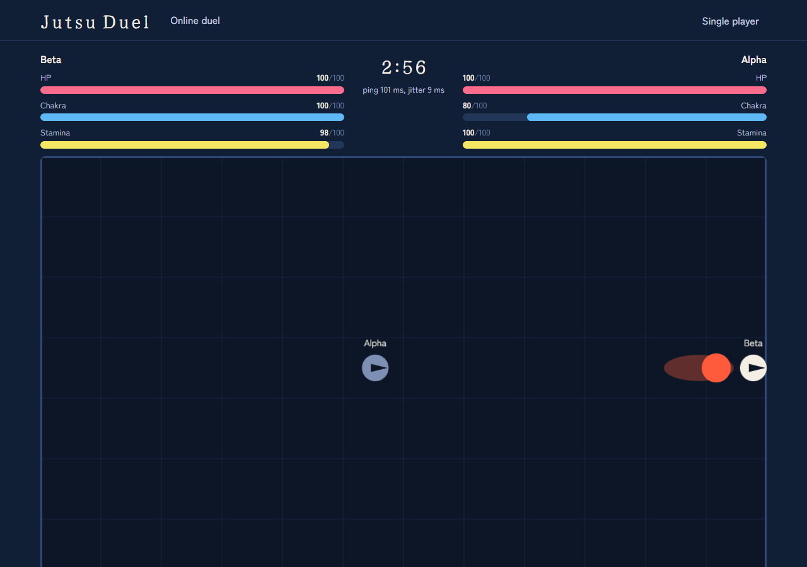

# Jutsu Duel (working title)

A desktop web game where you fight by performing Naruto-style hand signs on your webcam.
Hold a sign for a moment (150 ms) to register it; complete a sequence to cast a jutsu that flies
at your opponent. Five elements beat each other in a cycle, longer sequences hit harder, two
jutsu in the air at once clash, and a two-sign Substitution lets you dodge. First to bring the
other fighter to 0 HP in two minutes wins.

Version 1 is a playable demo against a bot with three difficulties, using the webcam or the
keyboard. Online 1v1 with live webcam video is designed and follows. Every piece of
franchise-specific wording lives in one content config, and all art, glyphs and sounds are
original, so the theme can be swapped.



## Status

Milestone v0.6.0: the full single-player demo. Live status, the update log and the roadmap are in
[`docs/PROGRESS.md`](docs/PROGRESS.md); release notes in [`CHANGELOG.md`](CHANGELOG.md); the
product and technical design in [`docs/DESIGN.md`](docs/DESIGN.md) and the visual design in
[`docs/FRONTEND_DESIGN.md`](docs/FRONTEND_DESIGN.md); working conventions in
[`CLAUDE.md`](CLAUDE.md).

One thing still needs the owner before the demo is complete end to end: a Supabase project for
accounts and match history (the app runs without one, see below). A trained recognition model
ships in the repository, so webcam mode works out of the box.

## Screenshots

| | |
|---|---|
|  |  |
| Pre-battle: the camera check asks you to hold one sign so the whole pipeline is proven first | The battle stage: HP bars, timer, flight strip, both sign trails, the Substitution seal |
|  |  |
| Results with the jutsu used and the match stats | Practice one jutsu with per-sign feedback |
|  |  |
| The Jutsu Book: every sequence, what beats what | Settings: theme, input, camera, keys, account |

The light theme is a setting; the landing page in it is at
[`docs/screenshots/landing-light.png`](docs/screenshots/landing-light.png).

## Setup

Requirements: Node 22 or newer, a desktop browser (Chrome or Edge recommended, 1280 px wide or
more), and optionally a Supabase project and `uv` for training.

```
npm install
cp .env.example .env.local        # optional: VITE_SUPABASE_URL and VITE_SUPABASE_ANON_KEY
npm run dev                       # http://localhost:5173
```

Without the Supabase variables the login page offers "Continue as dev user" in development
builds, so the whole game can be played locally; matches are simply not saved. With them, apply
the schema once per project as described in [`supabase/README.md`](supabase/README.md)
(`supabase db push`, or paste `supabase/migrations/*.sql` into the SQL editor in order).

### Playing with the keyboard

Pick "Keyboard" on the pre-battle page. Each sign has a key; hold it for a moment (150 ms).
The camera stays off in this mode, and the key map on the battle and practice pages is a sign
pad: click a sign button to register it, or press and hold one.

| Key | Sign | Key | Sign | Key | Sign |
|---|---|---|---|---|---|
| Q | Rat | A | Dragon | Z | Monkey |
| W | Ox | S | Snake | X | Bird |
| E | Tiger | D | Horse | C | Dog |
| R | Hare | F | Ram | V | Boar |

Keys can be rebound in Settings. The sequences are listed in the Jutsu Book in the app.

### Playing with the webcam

Webcam mode needs a trained recognition model at `public/models/signs-v1.json`. The repository
ships one trained on the owner's hands; it may read yours less well, and retraining on your own
recordings takes a few minutes:

1. `npm run dev`, open `/dev/recorder`, allow the camera, pick a label and capture about 100
   samples per sign (move and rotate your hands a little while it counts). Record `none` too:
   idle hands, transitions, one hand only. Export the session, ideally more than one on
   different days or lighting.
2. Put the exported files in `ml/data/raw/` and train:

   ```
   cd ml
   uv sync
   uv run train --data data/raw/*.json --out ../public/models/signs-v1.json
   ```

3. Check it with the browser's own inference code: `npm run model:check` runs the shipped model
   over every recording in `ml/data/raw/` and prints accuracy per sign (`uv run evaluate` does
   the same from Python).
4. Reload the app. The pre-battle camera check now asks you to hold the Ram sign; once it
   registers, "Start battle" unlocks.
5. Optional: `uv run references --data data/raw/*.json --out ../src/content/sign-references.json`
   refreshes the hand-sign figures (the skeleton drawn for each sign in the Jutsu Book, on the
   Practice page and on the key map) from your own recordings.

To re-record one sign, drop it from the old recording first: `uv run prune --data <file>
--drop ram`, then record, train and refresh the references as above.

Details, options and the evaluation command are in [`ml/README.md`](ml/README.md). The recorder
also shows the live prediction of the installed model, so a new model can be judged by eye.



## Online duel

A second mode at `/duel`: two players in separate browsers fight in real time in a top-down
arena, built from the specification in [`docs/handsign-duel/`](docs/handsign-duel/ALL_IN_ONE_SPEC.md).
The server owns every rule; clients only send intent.

```
npm run dev:duel                  # Vite on 5173 plus the duel server on ws://localhost:2567
```

To play alone, `npm run dev` is enough: open http://localhost:5173/duel, pick easy, normal or
hard under "Against a bot" and start. The match runs in the tab with the same rules, no server.

For two players, open http://localhost:5173/duel in two windows (or two machines pointed at the same server),
pick nicknames, create a duel in one and join with the invite code in the other, press Ready in
both. No account and no camera are needed in mock mode.

| Input | Action |
|---|---|
| W A S D | Move (220 units/s, diagonals normalised) |
| Space | Dodge: 150-unit dash, 35 stamina, 1.5 s cooldown, invulnerable 30–150 ms in |
| 1 / 2 / 3 | Select Fireball (Tiger, Boar, Horse), Lightning Spear (Rat, Bird, Tiger), Water Shield (Snake, Ram) |
| Q E R T Y U I | Mock signs Tiger, Boar, Horse, Rat, Bird, Snake, Ram |
| Backspace / Escape | Cancel the signs so far / help |

Webcam hand signs use the trained model and the same server validation; choose it on the duel
home page when a model is installed. HP regenerates 2/s after 6 s without damage, chakra 7/s,
stamina 20/s; a match lasts 180 s and ends by knockout, time, or forfeit after a 10 s
reconnection grace. Every number lives in `packages/duel-shared/src/config.ts`. What works, what
is limited and what was deliberately changed from the spec: [`IMPLEMENTATION_STATUS.md`](IMPLEMENTATION_STATUS.md)
and [`DECISIONS.md`](DECISIONS.md).



`npm run test:e2e` plays a complete two-browser match with Playwright. The duel server reads
`DUEL_SERVER_PORT`; the client reads `VITE_DUEL_SERVER_URL` (see `.env.example`).

## Commands

```
npm run dev            dev server with the dev-only routes (/dev/styleguide, /dev/recorder)
npm run dev:duel       dev server plus the online duel server (npm run duel:server for it alone)
npm run build          production build to dist/
npm run preview        serve the production build locally
npm run check          lint, format check, typecheck and tests; the merge gate for main
npm test               tests only (npm run test:watch to keep them running)
npm run test:e2e       Playwright: a full online duel in two browser contexts
npm run format         write Prettier formatting
npm run db:types       regenerate src/lib/database.types.ts from a linked Supabase project

cd ml && uv run pytest                 trainer tests, including TS/Python feature parity
cd ml && uv run train ...              train and export the model
cd ml && uv run evaluate ...           per-class report for an exported model
```

## How it is built

React 19, TypeScript, Vite and React Router on the front; Supabase (Auth and Postgres with Row
Level Security) for accounts, settings and match history; MediaPipe Hand Landmarker in the
browser for hand tracking; a small MLP trained with PyTorch and evaluated in plain TypeScript
for sign recognition. Vitest, ESLint and Prettier guard `main`.

```
src/engine/      The battle engine: pure, deterministic, timestamp-driven, no DOM. Typed events.
src/content/     Everything themed and tunable: names, flavour text, the roster, the balance config.
src/detection/   Camera, MediaPipe wrapper, the hands-v1 feature extractor, keyboard and ML detectors.
src/opponent/    The OpponentSource contract and the seeded bot (a remote player fits the same shape).
src/features/    Battle controller and HUD, practice, settings sync, results, history, recorder.
src/pages/       One file per route. src/components/ holds the design-system primitives.
src/lib/         Supabase client, settings store, API modules, small hooks.
src/duel/        The online duel client: session and prediction, inputs, canvas renderer, HUD, pages.
packages/duel-shared/  Pure rules of the online duel: config, simulation, movement, protocol schemas.
server/          Colyseus 0.18 server for the online duel: the room, synced state, rate limits.
supabase/        Migrations with RLS. ml/ is the uv-managed trainer. docs/ holds the design and progress.
```

The engine takes registered signs with timestamps and emits events (`jutsuCast`, `clash`, `hit`,
`dodge`, `ko`, ...). A detector produces per-frame sign predictions; a stabiliser turns them into
registered signs after a 150 ms hold. The keyboard detector and the webcam detector are
interchangeable, so the bot, the controller and the tests never know which one is in use. All
rules and numbers (100 HP, 120 s round, 12/18/26/36 damage for 3 to 6 signs, 1.5 s flight,
1.5x and 0.5x clash multipliers, the 8 s Substitution cooldown, the 2.5 s buffer reset) live in
`src/content/balance.config.ts`.

## Deploying

`vercel.json` configures a static Vite deployment: the SPA rewrite, camera permission for the
site's own origin, and cache headers for hashed assets and the model file. Set
`VITE_SUPABASE_URL` and `VITE_SUPABASE_ANON_KEY` in the project's environment; set
`VITE_ENABLE_DEV_TOOLS=true` on preview deployments if you want the recorder there. Commit a
trained `public/models/signs-v1.json` to ship webcam mode. Nothing deploys automatically.

## Contributing to this repository

Work happens on `feat/`, `fix/`, `docs/`, `chore/` and `test/` branches merged into `main`
through a pull request once `npm run check` passes. Commits follow Conventional Commits with a scope.
Milestones are tagged `v0.x.0` and recorded in `CHANGELOG.md`; `docs/PROGRESS.md` logs every
branch. Never commit `.env.local`.
