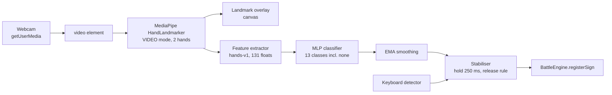
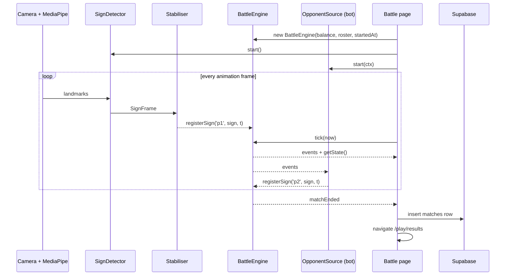
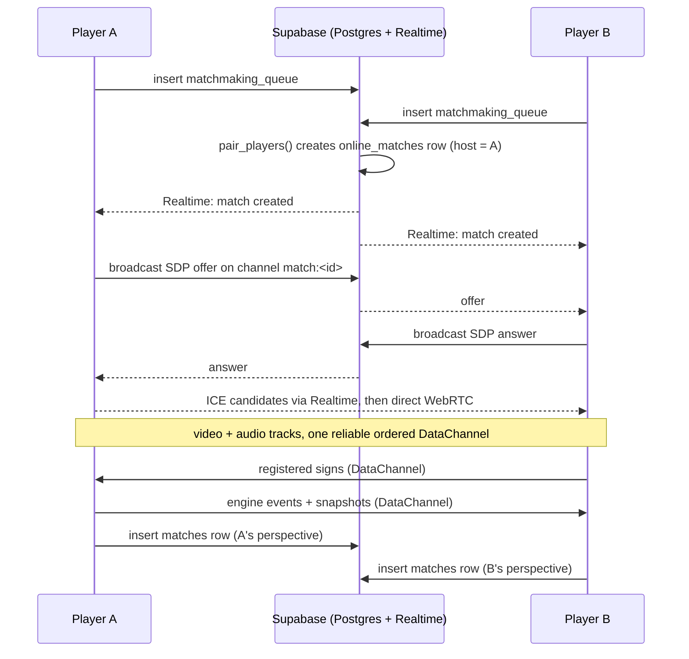

# Jutsu Duel: Design Document

Working title: **Jutsu Duel**. Status: approved by the owner on 2026-11-11 (decisions in
section 13); implementation in progress.
Companion documents: `docs/FRONTEND_DESIGN.md` (visual and UI spec) and `CLAUDE.md` (conventions).

Code uses neutral identifiers everywhere (`fire_short`, `substitution`, `tiger`). Every themed,
Naruto-flavoured name or string lives in one file, `src/content/content.config.ts`, so the whole
game can be rebranded by editing that file. Themed names in this document are the proposed values
of that file, not names baked into code.

---

## 1. Summary

A desktop browser game. A player performs hand signs in front of their webcam. MediaPipe tracks
both hands, a small classifier labels the pose, and a deterministic battle engine turns sequences
of signs into jutsus that damage the opponent. Version 1 is a complete single-player demo against
a bot with three difficulties, with accounts, match history and settings in Supabase. Online 1v1
with live peer-to-peer webcam video is designed here and built after v1.

### Goals for v1

- A match against the bot is winnable and legible: you can read the opponent's trail, react, and
  the rules reward risk.
- The whole loop works end to end: sign up, pick a difficulty, check the camera, fight, see
  results, see the match in history.
- Playable with the keyboard before any ML model exists, so every feature can be built and tested
  without a webcam.
- The recognition pipeline is trainable by the project owner alone: record, train, drop the model
  in, play.
- Everything that online 1v1 needs later (opponent abstraction, deterministic engine, typed
  events, media-stream-driven video panel) exists in v1 in the right shape.

### Non-goals for v1

- Online play, matchmaking, friends, ranked ladder, anti-cheat.
- Sound and visual effects beyond placeholders (hooks exist, content does not).
- Mobile or tablet support.
- OAuth providers, password reset flows beyond what Supabase gives for free.
- Localisation.

---

## 2. Glossary

| Term | Meaning |
|---|---|
| Sign | One of the 12 hand poses (`rat`, `ox`, `tiger`, `hare`, `dragon`, `snake`, `horse`, `ram`, `monkey`, `bird`, `dog`, `boar`). |
| Sequence | An ordered list of signs that casts a jutsu. |
| Buffer | The signs a player has registered so far toward a sequence. Shown to the opponent as the sign trail. |
| Jutsu | An attack (one of 10, two per element) or Substitution (defensive). |
| Element | `fire`, `wind`, `lightning`, `earth`, `water`. |
| In flight | The 1.5 s between a jutsu being cast and landing. |
| Clash | Two opposing jutsus resolving against each other because the second was cast while the first was in flight. |
| Substitution | The 2-sign defensive jutsu that negates an in-flight enemy jutsu. |
| Stabiliser | The input filter that turns noisy per-frame predictions into registered signs. |
| Detector | Anything that implements `SignDetector` and produces per-frame sign predictions (keyboard or ML). |
| Opponent source | Anything that implements `OpponentSource` and produces the opponent's registered signs (bot or remote player). |

---

## 3. Product scope and user flows

### 3.1 Primary flows

**First visit → first match**

1. Landing page explains the game in one screen and offers "Play" (→ sign up) and "Log in".
2. Sign up with email, password, and a unique username. If email confirmation is enabled on the
   Supabase project, a "check your inbox" state appears; otherwise the user lands on Home.
3. Home shows the menu. "Play vs Bot" → Pre-battle.
4. Pre-battle: choose difficulty; the camera check requests permission, shows the live preview
   with the landmark overlay, loads the model, and asks the player to hold one sign to confirm
   recognition works. Keyboard mode skips the camera check.
5. Battle: countdown, real-time fight, KO or time up.
6. Results: outcome, damage dealt, jutsus used; "Rematch" restarts with the same difficulty
   without the camera check; "Back to menu" returns Home. The match is saved to Supabase.

**Learning a jutsu**: Home → Jutsu Book (read the sequence and what it beats) → Practice (pick the
jutsu, get live feedback per sign, see completion time) → Play vs Bot.

**Training the recogniser (project owner only)**: `/dev/recorder` → pick label → countdown →
capture N samples → repeat for all labels and `none` → export JSON → `uv run train` in `/ml` →
copy the exported model to `public/models/` → play in webcam mode.

### 3.2 Secondary flows

- Returning user: Landing → Log in → Home (session is persisted, so usually straight to Home).
- Settings change persists to Supabase and applies immediately (camera, mirror, threshold, input
  mode, key bindings, volumes, username).
- Camera problems: permission denied, no camera, camera in use. Each state explains what happened
  and offers keyboard mode as a way to keep playing.
- Small screen: a full-page notice explains the game needs a desktop browser.

---

## 4. Pages and routes

| Route | Page | Auth | Notes |
|---|---|---|---|
| `/` | Landing | public | Redirects to `/home` when logged in. |
| `/login` | Log in | public | |
| `/signup` | Sign up | public | Username availability check before submit. |
| `/home` | Home / main menu | required | Play vs Bot, Practice, Jutsu Book, Match History, Settings, Online 1v1 (disabled, "coming soon"). |
| `/play` | Pre-battle | required | Difficulty select, input mode, camera check. |
| `/play/battle` | Battle | required | Requires battle config in memory; otherwise redirects to `/play`. |
| `/play/results` | Results | required | Requires a finished match in memory; otherwise redirects to `/play`. |
| `/practice` | Practice: pick a jutsu | required | |
| `/practice/:jutsuId` | Practice: one jutsu | required | Live per-sign feedback. |
| `/jutsu-book` | Jutsu Book | required | Jutsus by element + reference for all 12 signs. |
| `/history` | Match History | required | Paginated list from Supabase. |
| `/settings` | Settings | required | |
| `/dev/recorder` | Training data recorder | required, dev only | Registered only when `import.meta.env.DEV` or `VITE_ENABLE_DEV_TOOLS=true`. |
| `*` | 404 | public | |

Protected routes redirect to `/login?returnTo=<path>`. Pages under `/play` share one in-memory
`BattleSession` (difficulty, input mode, camera device, result) held in a React context, so a page
refresh mid-battle returns to `/play` rather than resuming a broken match.

---

## 5. Combat rules

All numbers live in `src/content/balance.config.ts` (section 5.6). Combat is real time; both
players act concurrently.

### 5.1 Health and victory

- Each player starts with `maxHp` = 100.
- A player whose HP reaches 0 or below loses immediately (`ko`).
- If both players reach 0 in the same clash, the match is a draw.
- A round lasts `roundDurationMs` = 120 000 ms. When time runs out, the player with more HP wins;
  equal HP is a draw.

### 5.2 Elements

Five elements in a cycle. "A beats B" means A is advantaged against B.

```
fire → wind → lightning → earth → water → fire
```

Fire beats Wind, Wind beats Lightning, Lightning beats Earth, Earth beats Water, Water beats Fire.
Every other pairing, including same-element, is neutral.

### 5.3 Sign registration and the buffer

Each player has a buffer of registered signs.

1. A sign is **registered** when the stabiliser has seen the same sign above the confidence
   threshold continuously for `signHoldMs` = 250 ms. After a sign registers, the same sign cannot
   register again until a different sign or `none` has been observed (release rule), so holding
   a pose never double-registers.
2. On registration, the engine appends the sign to the buffer if the result is a prefix of (or
   equal to) at least one sequence in the roster.
3. If it is not a prefix of any sequence, the buffer **resets** to `[sign]` when that single sign
   starts some sequence, otherwise to `[]`. This is how a player deliberately abandons a sequence:
   start a new opener.
4. A sign identical to the last buffered sign is ignored (defensive; the stabiliser already
   prevents it).
5. If `bufferResetMs` = 2 500 ms pass without a new registration, the buffer resets to `[]`.
6. When the buffer equals a full sequence, the jutsu **casts automatically** and the buffer
   clears.
7. Every registration is emitted as an event so the opponent sees the trail as it happens.

### 5.4 Attacks, flight and clashes

- Casting an attack creates a projectile that lands after `flightMs` = 1 500 ms.
- Base damage depends only on sequence length:

  | Signs | Damage |
  |---|---|
  | 3 | 12 |
  | 4 | 18 |
  | 5 | 26 |
  | 6 | 36 |

- **Unanswered**: the projectile lands at 1.0x on the opponent when its flight time elapses.
- **Clash**: if a player casts an attack while an opponent projectile is in flight, the two
  resolve immediately against each other (the oldest opponent projectile if several). The
  advantaged element lands at `clashAdvantageMultiplier` = 1.5x, the disadvantaged at
  `clashDisadvantageMultiplier` = 0.5x. Neutral matchups both land at 1.0x. Both projectiles are
  removed. Damage is rounded to the nearest integer; with the table above every result is a whole
  number (6, 9, 13, 18 at 0.5x; 18, 27, 39, 54 at 1.5x).
- Resolving at the moment of the second cast (rather than when the first would have landed)
  keeps the rule simple, removes the possibility of both players having projectiles in flight at
  once, and gives a clean "clash" moment for effects.
- A player can have more than one projectile in flight only with very fast input (three keyboard
  signs in under 1.5 s); the engine handles a list, so nothing breaks.

### 5.5 Substitution

- A 2-sign jutsu. Completing it while at least one enemy projectile is in flight negates the
  oldest one (`dodge` event). Nothing lands.
- It then goes on cooldown for `substitutionCooldownMs` = 8 000 ms. Completing the sequence during
  cooldown does nothing except reset the buffer (`substitutionFailed` with reason `cooldown`).
- Completing it with nothing in flight ("whiff") also starts the cooldown
  (`substitutionWhiffTriggersCooldown` = true), so it cannot be spammed as a permanent shield.

### 5.6 Balance config

```ts
// src/content/balance.config.ts (shape; values as above)
export const BALANCE = {
  maxHp: 100,
  roundDurationMs: 120_000,
  flightMs: 1_500,
  damageBySignCount: { 3: 12, 4: 18, 5: 26, 6: 36 },
  clashAdvantageMultiplier: 1.5,
  clashDisadvantageMultiplier: 0.5,
  substitutionCooldownMs: 8_000,
  substitutionWhiffTriggersCooldown: true,
  signHoldMs: 250,
  bufferResetMs: 2_500,
  ignoreRepeatedSign: true,
  defaultConfidenceThreshold: 0.7,
  smoothingAlpha: 0.5,            // EMA over class probabilities before the stabiliser
  countdownMs: 3_000,
  elementCycle: ['fire', 'wind', 'lightning', 'earth', 'water'], // each beats the next; last beats first
  bot: { easy: {...}, medium: {...}, hard: {...} },                // section 8.6
} as const;
```

A unit test asserts that the roster is prefix-free and that every sequence length has a damage
entry, so a tuning mistake fails CI rather than a match.

---

## 6. Demo roster (for approval)

### 6.1 Design rules behind the roster

- **One opener per element.** Each element's two jutsus start with the same sign, and that sign
  starts nothing else. Substitution has its own opener. Readers learn six openers and can tell the
  element from the first sign of the trail; the second sign tells them short or long. This makes
  the reading game immediate and gives the bot something concrete to react to. If this feels too
  revealing in playtesting, openers can be shared between two elements without changing code.
- Openers never appear later in a sequence, so a trail is unambiguous at a glance.
- No sign repeats within a sequence, and no sign appears twice in a row anywhere (the detector
  needs a change of pose to register a new sign).
- Prefix-free follows by construction: sequences that share a first sign belong to the same
  element and differ at the second sign.
- Short and long lengths are mixed across elements so each element has a different rhythm.

### 6.2 Signs and openers

| Sign ID | Themed name | Role |
|---|---|---|
| `tiger` | Tiger | opener: Fire |
| `bird` | Bird | opener: Wind |
| `dragon` | Dragon | opener: Lightning |
| `ox` | Ox | opener: Earth |
| `snake` | Snake | opener: Water |
| `ram` | Ram | opener: Substitution |
| `rat`, `hare`, `horse`, `monkey`, `dog`, `boar` | Rat, Hare, Horse, Monkey, Dog, Boar | continuation signs |

### 6.3 Jutsus

| ID | Element | Themed name (content config) | Signs | Sequence | Damage |
|---|---|---|---|---|---|
| `fire_short` | Fire | Fireball | 3 | Tiger → Horse → Rat | 12 |
| `fire_long` | Fire | Great Fire Annihilation | 6 | Tiger → Boar → Dog → Hare → Monkey → Horse | 36 |
| `wind_short` | Wind | Wind Blade | 3 | Bird → Hare → Dog | 12 |
| `wind_long` | Wind | Great Breakthrough | 5 | Bird → Monkey → Rat → Boar → Horse | 26 |
| `lightning_short` | Lightning | Lightning Strike | 4 | Dragon → Rat → Boar → Monkey | 18 |
| `lightning_long` | Lightning | Thunderfall | 6 | Dragon → Dog → Horse → Hare → Rat → Boar | 36 |
| `earth_short` | Earth | Earth Spear | 4 | Ox → Dog → Monkey → Hare | 18 |
| `earth_long` | Earth | Rising Landslide | 5 | Ox → Boar → Rat → Horse → Dog | 26 |
| `water_short` | Water | Water Bullet | 3 | Snake → Monkey → Boar | 12 |
| `water_long` | Water | Water Dragon | 6 | Snake → Rat → Hare → Dog → Horse → Monkey | 36 |
| `substitution` | none | Substitution | 2 | Ram → Boar | negates |

Element rhythm: Fire 3/6, Wind 3/5, Lightning 4/6, Earth 4/5, Water 3/6.

### 6.4 Why this plays well (expected dynamics)

With a realistic human cadence of roughly 0.7–0.9 s per sign, a 3-sign jutsu takes about 2.4 s
and lands at about 3.9 s. A player who reads the opener at 0.5 s and answers with the advantaged
3-sign jutsu finishes around 3 s, inside the flight window, and wins the clash 18 to 6. The first
mover's counter-play is to read *that* and switch openers, paying time for it, or to go long and
accept that a short counter clashes evenly (36 × 0.5 = 18 vs 12 × 1.5 = 18). Substitution is the
reactive skill check: two signs in 1.5 s once the enemy projectile is visible, at the cost of an
8 s cooldown. The bot's harder levels play exactly this reading game.

---

## 7. Sign recognition pipeline



### 7.1 Camera service

`src/detection/camera.ts` wraps `getUserMedia` and `enumerateDevices`: requests
`{ video: { deviceId, width: 1280, height: 720, frameRate: 30 } }`, falls back to default
constraints on `OverconstrainedError`, exposes the `MediaStream`, and maps errors to a typed
`CameraError` (`permission-denied`, `not-found`, `in-use`, `unknown`) that the UI renders.
Device labels are only available after permission, so the settings camera picker shows
"Camera 1, Camera 2" until then.

### 7.2 Hand tracking

`@mediapipe/tasks-vision` `HandLandmarker`, `runningMode: 'VIDEO'`, `numHands: 2`, GPU delegate
with CPU fallback. The model file (`hand_landmarker.task`) and WASM assets load lazily on the
first page that needs the camera and are cached by the browser. Detection runs in a
`requestAnimationFrame` loop on the main thread in v1 (typically 8–15 ms per frame on an
integrated GPU); moving it to a Web Worker with `OffscreenCanvas` is a documented optimisation if
battle rendering suffers. The un-mirrored frame is always what MediaPipe sees; mirroring is a
display transform only, so handedness labels stay consistent regardless of the mirror setting.

### 7.3 Feature spec `hands-v1`

Per frame, MediaPipe gives up to two hands, each with 21 landmarks (x, y normalised to the image,
z roughly in the same units as x) and a handedness label.

1. **Aspect correction**: multiply x by `width / height` so geometry is not squashed.
2. **Hand ordering**: slot 0 = hand labelled `Left`, slot 1 = `Right`. If both carry the same
   label, order by wrist x (leftmost first). A missing hand leaves its slot zero-filled.
3. **Per-hand normalisation**: subtract the wrist (landmark 0) from all 21 points; divide by the
   hand scale = distance from wrist to middle-finger MCP (landmark 9), which is stable regardless
   of finger curl. 21 × 3 = 63 values per hand, 126 for two hands. Wrist-relative and
   scale-divided means the features are invariant to position and distance from the camera.
4. **Inter-hand geometry**: wrist(slot 1) − wrist(slot 0), divided by the mean hand scale.
   3 values. Zero when either hand is missing. Several signs differ mainly in how the hands sit
   relative to each other, which the per-hand normalisation would otherwise discard.
5. **Presence flags**: one per slot. 2 values.

Total **131** features: the 126 landmark features you specified plus 5 that cost nothing and
help disambiguate two-handed poses. Standardised with mean/std computed at training time and
stored in the model file.

### 7.4 Classifier and export format

**Model**: multilayer perceptron, 131 → 128 → 64 → 13, ReLU, dropout 0.2 in training, softmax
output. About 27k parameters. Classes: the 12 signs plus `none`. Inference is under 0.5 ms in
plain TypeScript, with no ML runtime dependency in the browser.

Why an MLP over alternatives: a kNN needs the whole dataset shipped and is slower per frame; a
temporal model (GRU over frames) is unnecessary because signs are static poses and the stabiliser
already handles time; TensorFlow.js or ONNX Runtime Web would add 1–10 MB of runtime for a
network small enough to run by hand.

**Export format**: a single JSON file, `public/models/signs-v1.json`.

```jsonc
{
  "format": "jutsu-duel-mlp",
  "version": 1,
  "createdAt": "2026-11-20T18:00:00Z",
  "featureSpec": "hands-v1",
  "inputDim": 131,
  "labels": ["none", "rat", "ox", "tiger", "hare", "dragon", "snake", "horse", "ram", "monkey", "bird", "dog", "boar"],
  "standardisation": { "mean": [131 floats], "std": [131 floats] },
  "layers": [
    { "type": "dense", "weights": [[128 x 131 floats]], "bias": [128 floats], "activation": "relu" },
    { "type": "dense", "weights": [[64 x 128 floats]], "bias": [64 floats], "activation": "relu" },
    { "type": "dense", "weights": [[13 x 64 floats]], "bias": [13 floats], "activation": "softmax" }
  ],
  "metrics": { "valAccuracy": 0.97, "perClassRecall": {}, "confusion": [[...]] },
  "training": { "samples": 6200, "sessions": 4, "epochs": 60, "augmentation": ["jitter", "scale", "rotate"] }
}
```

Weights are rounded to five decimals; the file is roughly 150 KB before gzip. A `SignClassifier`
interface (`predict(features): Float32Array`) wraps it so a different model can replace it.

**Runtime post-processing**: exponential moving average over the probability vector
(`smoothingAlpha` = 0.5), then arg-max; if the max probability is below the user's confidence
threshold the frame is `none`. The stabiliser then applies the 250 ms hold and release rules.

### 7.5 `SignDetector` interface

```ts
export interface SignFrame {
  t: number;                       // ms, performance.now() domain
  sign: SignId | 'none';
  confidence: number;              // 0..1
  probabilities?: Float32Array;    // full vector for debug UI
  landmarks?: HandLandmarks[];     // for overlays; absent for keyboard
}

export interface SignDetector {
  readonly kind: 'keyboard' | 'ml';
  start(): Promise<void>;
  stop(): void;
  onFrame(cb: (frame: SignFrame) => void): Unsubscribe;
  readonly status: 'idle' | 'loading' | 'ready' | 'error';
  readonly error?: DetectorError;
}
```

- **KeyboardSignDetector**: 12 keys map to the 12 signs (defaults in section 9.4). While a key is
  held, it emits a frame with that sign at confidence 1.0 every animation frame; when released it
  emits `none`. Signs therefore register after the same 250 ms hold as the webcam, so keyboard play
  has the same tempo and the engine sees identical input. (A dev toggle can shorten the hold for
  tests; see open questions.)
- **MlSignDetector**: camera → MediaPipe → features → classifier → EMA → frame. Also exposes the
  raw landmarks so the overlay and the recorder can draw them.

The stabiliser (`src/engine/stabilizer.ts`) is pure TypeScript and unit tested: it takes
`SignFrame`s and emits `(sign, t)` registrations.

### 7.6 Recorder (`/dev/recorder`)

- Webcam preview with the landmark overlay and the live classifier prediction if a model is
  loaded, so you can test a model right where you record.
- Label picker: the 12 signs and `none`. Samples-per-capture input (default 100). Countdown
  (3 s) then capture at detection rate until N frames have at least one hand (for `none`, frames
  with zero hands are accepted). A guidance line asks you to move and rotate the hands slightly
  during capture for robustness.
- Session panel: per-label counts, undo last capture, clear session, import a previous export to
  append, export session JSON (download).
- Export format `recording-v1` stores raw landmarks, not features, so feature engineering can
  change without re-recording:

```jsonc
{
  "format": "jutsu-duel-recording",
  "version": 1,
  "sessionId": "uuid",
  "recordedAt": "2026-11-15T10:00:00Z",
  "device": { "userAgent": "...", "videoWidth": 1280, "videoHeight": 720, "mirror": true },
  "samples": [
    {
      "label": "tiger",
      "t": 123456.7,
      "hands": [
        { "handedness": "Left", "score": 0.98, "landmarks": [[x, y, z] /* x21 */], "worldLandmarks": [[x, y, z] /* x21 */] },
        { "handedness": "Right", "score": 0.97, "landmarks": [...], "worldLandmarks": [...] }
      ]
    }
  ]
}
```

Recordings contain landmark coordinates only, never images. `ml/data/raw/` is git-ignored by
default.

### 7.7 Training (`/ml`, managed with uv)

- `uv run train --data data/raw/*.json --out ../public/models/signs-v1.json`
  - Re-implements `hands-v1` feature extraction in Python. A parity test loads
    `ml/tests/fixtures/features-golden.json` (features computed by the TypeScript extractor for a
    handful of samples) and asserts the Python extractor matches to 1e-6, so training and
    inference can never silently diverge.
  - Splits train/validation **by session**, so accuracy reflects a new recording session rather
    than near-duplicate frames.
  - Augmentation on raw landmarks: Gaussian jitter, uniform scale, small in-plane rotation.
    Optional horizontal mirror with slot swap (flag), for mirror-handed players.
  - Class weighting for imbalance; early stopping on validation loss; prints a confusion matrix
    and per-class recall; writes metrics into the model file.
- `uv run evaluate --model ... --data ...` prints metrics for any recording set.
- Stack: Python 3.12, PyTorch (CPU), NumPy, scikit-learn (split and metrics), pytest.
  Training takes seconds on CPU.

---

## 8. Architecture

### 8.1 Folder structure

```
.
├── docs/                      DESIGN.md, FRONTEND_DESIGN.md, ADRs if needed
├── ml/                        uv project: train, evaluate, feature parity tests
├── public/models/             exported classifier JSON (MediaPipe assets from CDN by default)
├── supabase/migrations/       SQL migrations
├── src/
│   ├── app/                   router, providers, route guards, app shell
│   ├── pages/                 one component per route
│   ├── components/            design-system primitives (Button, Seal, HpBar, VideoPanel, ...)
│   ├── features/
│   │   ├── auth/              session provider, login/signup forms, username check
│   │   ├── battle/            BattleController (wires engine + detector + opponent + clock), HUD
│   │   ├── practice/
│   │   ├── jutsu-book/
│   │   ├── history/
│   │   ├── settings/
│   │   └── recorder/          dev-only
│   ├── engine/                PURE TS: battle engine, stabiliser, sequence matcher, types, events
│   ├── detection/             SignDetector interface, keyboard + ML detectors, camera, mediapipe,
│   │                          features, classifier
│   ├── opponent/              OpponentSource interface, bot (remote later)
│   ├── content/               content.config.ts (themed strings), balance.config.ts, roster.ts
│   ├── lib/                   supabase client, database types, settings schema, utils
│   └── styles/                tokens.css, global.css, fonts
└── tests/                     cross-cutting tests and fixtures (unit tests sit next to source)
```

`src/engine/**` must not import React, DOM types, or anything outside `src/engine` and
`src/content`. Enforced by an ESLint `no-restricted-imports` rule and a dedicated
`tsconfig.engine.json` whose `lib` is `["ES2022"]` only (no `DOM`), run as part of `typecheck`.

### 8.2 Battle engine

Deterministic, synchronous, driven entirely by method calls carrying timestamps. No `Date.now`,
no randomness, no timers.

```ts
export class BattleEngine {
  constructor(opts: { balance: BalanceConfig; roster: readonly JutsuDef[]; startedAt: number });
  registerSign(player: PlayerId, sign: SignId, t: number): void;
  forfeit(player: PlayerId, t: number): void;
  tick(t: number): void;                        // advance time: landings, resets, cooldowns, timeout
  subscribe(listener: (event: EngineEvent) => void): Unsubscribe;
  getState(): BattleState;                      // immutable snapshot, new object only when changed
}
```

```ts
type PlayerId = 'p1' | 'p2';

interface PlayerState {
  hp: number;
  buffer: SignId[];
  bufferUpdatedAt: number | null;
  substitutionReadyAt: number;                  // 0 when ready
  stats: { damageDealt: number; damageTaken: number; jutsusCast: Record<JutsuId, number>;
           substitutions: number; clashesWon: number; clashesLost: number };
}

interface Projectile { id: number; caster: PlayerId; jutsuId: JutsuId; element: Element;
                       baseDamage: number; castAt: number; landsAt: number }

interface BattleState {
  phase: 'active' | 'ended';
  startedAt: number; endsAt: number; now: number;
  players: Record<PlayerId, PlayerState>;
  inFlight: Projectile[];
  result?: { winner: PlayerId | null; reason: 'ko' | 'timeout' | 'forfeit' };
}
```

Every input method first advances internal time to `t` (processing anything due before `t`),
then applies the input. Inputs with `t` earlier than the current time are clamped to current
time (relevant for networked play; never happens locally).

### 8.3 Engine events

```ts
type EngineEvent =
  | { type: 'matchStarted'; t: number }
  | { type: 'signRegistered'; t: number; player: PlayerId; sign: SignId; buffer: SignId[] }
  | { type: 'bufferReset'; t: number; player: PlayerId; reason: 'timeout' | 'mismatch' | 'cast' }
  | { type: 'jutsuCast'; t: number; player: PlayerId; jutsuId: JutsuId; element: Element; projectileId: number; landsAt: number }
  | { type: 'clash'; t: number; a: { projectileId: number; multiplier: number }; b: { projectileId: number; multiplier: number } }
  | { type: 'hit'; t: number; target: PlayerId; projectileId: number; jutsuId: JutsuId; damage: number; hpAfter: number; viaClash: boolean }
  | { type: 'dodge'; t: number; player: PlayerId; negatedProjectileId: number }
  | { type: 'substitutionFailed'; t: number; player: PlayerId; reason: 'cooldown' | 'nothingInFlight' }
  | { type: 'cooldownReady'; t: number; player: PlayerId }
  | { type: 'ko'; t: number; loser: PlayerId }
  | { type: 'matchEnded'; t: number; winner: PlayerId | null; reason: 'ko' | 'timeout' | 'forfeit' };
```

The six events you named are the core; the rest make the HUD and the bot simpler. Sound and
visual effects later subscribe to this same stream through an `EffectsBus`; v1 ships placeholder
effects only (a flash on hit, a burst glyph on clash). As built, there is no `matchStarted`
event: the engine is active from construction and the page knows the start time; the clock
freezes at the end of the match so the snapshot's `now` reads as the final time.

### 8.4 Engine test plan (v0.2.0)

- Damage table for 3/4/5/6 signs; unknown length throws at construction.
- Element cycle: every ordered pair returns the correct advantage; same element is neutral.
- Buffer: prefix extension, mismatch reset to `[sign]` and to `[]`, timeout reset at exactly
  2 500 ms and not at 2 499 ms, repeated sign ignored, auto-cast on completion.
- Flight: unanswered projectile lands at `castAt + 1500` at 1.0x, not earlier.
- Clash: advantaged/disadvantaged/neutral multipliers, rounding, both projectiles removed, oldest
  opponent projectile chosen, events in order (`clash`, `hit`, `hit`).
- Substitution: negates the oldest enemy projectile, cooldown exactly 8 000 ms, whiff rule,
  cooldown rule, `cooldownReady` emitted once.
- KO: hit to 0 ends the match, further inputs ignored, simultaneous KO is a draw.
- Timeout: higher HP wins, equal HP draws, no further events after end.
- Determinism: the same scripted input sequence yields identical event logs across runs.
- Roster invariants: prefix-free, no repeated consecutive signs, lengths covered by the damage
  table.
- Stabiliser: hold threshold, release rule, threshold boundary, `none` gaps.

### 8.5 `OpponentSource`

```ts
export interface OpponentSource {
  readonly kind: 'bot' | 'remote';
  readonly displayName: string;
  readonly mediaStream: MediaStream | null;     // null for bot → avatar placeholder
  readonly status: 'connecting' | 'ready' | 'disconnected';
  start(ctx: OpponentContext): void;            // ctx: engine events + snapshot + local player id
  stop(): void;
  onSign(cb: (sign: SignId, t: number) => void): Unsubscribe;
  onStatus(cb: (status: OpponentSource['status']) => void): Unsubscribe;
}
```

The `BattleController` forwards `onSign` to `engine.registerSign('p2', ...)`. The bot calls it
from its own timers; a remote player implementation will call it from network messages. The
battle page never knows which it is.

### 8.6 Bot design

The bot is a state machine ticked every 100 ms with a seeded PRNG (seed shown in dev tools so a
match can be replayed). It never touches engine internals; it reads the same events and
snapshots the UI does.

States: `idle` (think time) → `weaving` (emits one sign per interval, with per-sign jitter) →
back to `idle` after cast. Interrupts: `react` (abandon current sequence to counter) and
`substitute`.

| Parameter (per difficulty) | easy (Genin) | medium (Chunin) | hard (Jonin) |
|---|---|---|---|
| Sign interval ms (mean ± jitter) | 950 ± 200 | 750 ± 150 | 550 ± 100 |
| Think time between jutsus ms | 2 000–4 000 | 1 000–2 500 | 400–1 500 |
| Long jutsu preference | 0.2 | 0.5 | 0.6 (0.8 if player buffer is empty) |
| Misfire chance per sign (wrong sign, resets own buffer) | 0.10 | 0.05 | 0.02 |
| Reads player's trail after N signs | never | 2 | 1 |
| Counter with advantaged element when read | 0 | 0.5 | 0.85 |
| Substitution chance when enemy projectile appears | 0.15 | 0.45 | 0.75 |
| Reaction delay ms | 800 | 500 | 320 |

The hard bot also times counters: it estimates the player's cadence from their trail timestamps
and delays its final sign so its jutsu completes inside the player's flight window when that is
achievable, forcing a clash it is advantaged in. All parameters live in `balance.config.ts`.

### 8.7 Battle controller and data flow



- The clock is `performance.now()`; the engine receives absolute ms and stores `startedAt`.
- UI subscribes to the engine with `useSyncExternalStore` on `getState()`; the HUD renders from
  the snapshot and uses events only for transient effects.
- `BattleController` is a plain class (no React) so the same wiring can be unit tested with a
  fake detector and a scripted opponent.

### 8.8 State management and data access

- No global state library. React context for auth session, settings, and the current
  `BattleSession`; the engine is its own external store.
- Supabase access is wrapped in small typed functions in `src/lib/api/*.ts` (`saveMatch`,
  `listMatches`, `loadSettings`, `saveSettings`, `isUsernameAvailable`, `updateUsername`). Pages
  use `useAsync`-style hooks with explicit `loading | error | data` states.
- Settings load on login, merge with defaults through a zod schema (unknown keys dropped, missing
  keys defaulted), cache in `localStorage` for instant startup, and write through to Supabase
  debounced at 500 ms.
- A failed `saveMatch` queues the row in `localStorage` and retries on the next app load, so a
  flaky connection at the end of a match does not lose history.

### 8.9 Content and balance configuration

- `src/content/content.config.ts`: game title, tagline, element names, sign names and hand-pose
  descriptions, jutsu names and flavour lines, difficulty names (Genin, Chunin, Jonin), bot
  display names, battle callouts ("Fight", "Victory", "Defeat", "Draw"), and any other themed
  word. Typed as `ContentConfig`; a test asserts every roster ID has a name entry.
- `src/content/balance.config.ts`: every number from section 5 and the bot table.
- `src/content/roster.ts`: the jutsu definitions (ID, element, sequence) referencing sign IDs.
  Game design data, not branding, so it stays separate from content strings.

---

## 9. Data model

Supabase Postgres with Row Level Security on every table. Migrations in `supabase/migrations/`.
Generated types in `src/lib/database.types.ts` (via `supabase gen types`, committed).

### 9.1 Tables

```sql
-- profiles: one row per auth user, created by trigger on signup
create table public.profiles (
  id          uuid primary key references auth.users (id) on delete cascade,
  username    text not null unique
              check (username ~ '^[a-z0-9_]{3,20}$'),
  created_at  timestamptz not null default now(),
  updated_at  timestamptz not null default now()
);

-- matches: one row per completed match, written by the player who played it
create table public.matches (
  id                 uuid primary key default gen_random_uuid(),
  player_id          uuid not null references public.profiles (id) on delete cascade,
  opponent_type      text not null check (opponent_type in ('bot', 'human')),
  bot_difficulty     text check (bot_difficulty in ('easy', 'medium', 'hard')),
  opponent_id        uuid references public.profiles (id),      -- future: human opponent
  result             text not null check (result in ('win', 'loss', 'draw')),
  end_reason         text not null check (end_reason in ('ko', 'timeout', 'forfeit')),
  input_mode         text not null check (input_mode in ('webcam', 'keyboard')),
  duration_seconds   integer not null check (duration_seconds >= 0),
  player_hp_left     integer not null,
  opponent_hp_left   integer not null,
  damage_dealt       integer not null default 0,
  damage_taken       integer not null default 0,
  jutsus_used        jsonb not null default '{}'::jsonb,         -- { "fire_short": 2, "substitution": 1 }
  balance_version    text not null default '1',                  -- which tuning the match was played under
  created_at         timestamptz not null default now(),
  constraint bot_has_difficulty check (opponent_type <> 'bot' or bot_difficulty is not null)
);
create index matches_player_created_idx on public.matches (player_id, created_at desc);

-- user_settings: one jsonb blob per user, validated client-side with zod
create table public.user_settings (
  user_id     uuid primary key references public.profiles (id) on delete cascade,
  settings    jsonb not null default '{}'::jsonb,
  updated_at  timestamptz not null default now()
);
```

Additions over the starting point: `end_reason`, `input_mode`, `damage_dealt`, `damage_taken`,
`opponent_id` (nullable, for online later), `balance_version` (so history stays interpretable
after tuning), and a `created_at` index for the history page.

### 9.2 Row Level Security

```sql
alter table public.profiles      enable row level security;
alter table public.matches       enable row level security;
alter table public.user_settings enable row level security;

-- Each user reads and writes only their own rows.
create policy "profiles: own row"      on public.profiles      for all using (auth.uid() = id)      with check (auth.uid() = id);
create policy "matches: own rows"      on public.matches       for all using (auth.uid() = player_id) with check (auth.uid() = player_id);
create policy "user_settings: own row" on public.user_settings for all using (auth.uid() = user_id) with check (auth.uid() = user_id);
```

Online 1v1 will need other players to read a profile's username; that will be a separate, narrower
select policy added with the online migration, not a v1 change.

### 9.3 Functions and triggers

- `handle_new_user()` (security definer, trigger `after insert on auth.users`): inserts into
  `profiles` using `raw_user_meta_data ->> 'username'`, lower-cased. The client passes the
  username as `options.data.username` to `supabase.auth.signUp`. If the username is taken in the
  race between the availability check and signup, the trigger fails and signup returns an error
  the form shows.
- `is_username_available(candidate text) returns boolean` (security definer, callable by anon and
  authenticated): lets the signup form check availability without a public read policy on
  `profiles`.
- `set_updated_at()` trigger on `profiles` and `user_settings`.
- Username change: `update profiles set username = ... where id = auth.uid()`, allowed by RLS;
  uniqueness enforced by the constraint.

### 9.4 Settings schema (client, zod)

```ts
{
  version: 1,
  theme: 'system' | 'dark' | 'light',       // default 'system'; applied before first paint
  inputMode: 'webcam' | 'keyboard',          // default 'webcam'
  cameraDeviceId: string | null,
  mirrorVideo: boolean,                      // default true
  showLandmarks: boolean,                    // default true
  confidenceThreshold: number,               // 0.5–0.95, default 0.7
  keyBindings: Record<SignId, string>,       // KeyboardEvent.code values
  volume: { master: number; sfx: number; music: number },  // 0–1, stored now, used later
}
```

Default key bindings follow the zodiac order on a 4 × 3 block:
`Q W E R` = Rat, Ox, Tiger, Hare; `A S D F` = Dragon, Snake, Horse, Ram; `Z X C V` = Monkey,
Bird, Dog, Boar.

---

## 10. Online 1v1 plan (design only; built after v1)

### 10.1 Overview

Two browsers, one match. Supabase does matchmaking and signalling; WebRTC carries video and game
input peer to peer; one peer's engine is authoritative.



### 10.2 Matchmaking

- Table `matchmaking_queue (user_id pk, joined_at, region, rating)`; client inserts a row to join
  and deletes it to leave. A row older than 60 s is considered stale.
- Postgres function `pair_players()` runs on insert (trigger) and pairs the two oldest compatible
  rows atomically (`select ... for update skip locked`), creating `online_matches (id, host_id,
  guest_id, status, created_at)` and deleting the queue rows. Both clients receive the new row via
  Realtime Postgres Changes filtered on their user id.
- Online matches record into the same `matches` table with `opponent_type = 'human'` and
  `opponent_id` set.

### 10.3 Signalling and media

- Supabase Realtime Broadcast on a private channel `match:<id>` (Realtime authorisation policies
  restrict it to the two participants). Messages: `offer`, `answer`, `ice`, `ready`, `leave`.
- One `RTCPeerConnection` with the local camera track (and optional microphone), using the same
  `MediaStream` the detector already consumes. The remote track is passed straight into the
  opponent `VideoPanel`'s `mediaStream` prop, which is why that prop exists in v1.
- ICE servers: public STUN plus a TURN service (Cloudflare Calls TURN or Metered). Roughly a
  fifth of connections need TURN; without it those matches fail to connect.
- One reliable ordered `RTCDataChannel` for game messages. If the data channel fails to open
  within 5 s, fall back to Realtime Broadcast for game messages (higher latency, still playable).

### 10.4 Keeping game state in sync

- **Host-authoritative engine.** The host (the player who created the offer) runs the authoritative
  `BattleEngine`. The guest sends each registered sign `{ sign, tLocal }`; the host applies it at
  host receive time, clamped so network jitter cannot reorder a player's own signs.
- Host streams every `EngineEvent` to the guest plus a full `BattleState` snapshot every 500 ms.
  The guest renders from a mirror engine that applies host events and is replaced wholesale by
  each snapshot, so any divergence lasts at most half a second.
- The guest shows its own trail optimistically (local echo) and accepts host correction; the host
  decides when a buffer timed out.
- `RemoteOpponentSource` implements `OpponentSource`: on the host it emits the guest's signs; on
  the guest side the roles invert through a thin adapter so the battle page code is identical.
- Clock: engine time is host time. A simple ping/pong over the data channel estimates offset so
  the guest's timer matches the host's within a few tens of ms.
- Determinism and the event log make a post-match replay possible, which is also the basis for
  future anti-cheat verification.

### 10.5 Disconnects

- Heartbeat every second on the data channel. 3 s without one, or ICE state `disconnected`,
  pauses the match (host emits a pause; engine supports it by not advancing time) and shows a
  "Reconnecting" overlay to both.
- ICE restart is attempted; Realtime presence tells each side whether the other is still online.
- 20 s without recovery ends the match as a forfeit by the disconnected player. Each remaining
  client writes its own `matches` row. If the host disappears, the guest writes its row from its
  last snapshot. Trusting clients here is acceptable until anti-cheat work.
- Leaving the page mid-match sends `leave` and counts as a forfeit.

### 10.6 Future work after online 1v1

- Anti-cheat: server-side replay of event logs, sanity limits on sign cadence, signed results.
- Ranked ladder (Glicko-2 on `profiles`), seasons, placement matches.
- Friends list, direct challenges, private lobbies.
- Spectating via a third WebRTC leg or recorded replays.
- Sound design and real visual effects on the `EffectsBus`.
- Worker-based detection, custom MediaPipe model hosting, mobile exploration.

---

## 11. Non-functional requirements

- **Performance**: detection loop under 16 ms per frame on an integrated GPU laptop; battle HUD
  renders at 60 fps; app JS under 350 KB gzipped excluding MediaPipe assets, which load lazily
  only on camera pages. Fonts self-hosted and preloaded.
- **Browsers**: Chrome and Edge current and previous version are the supported targets. Firefox
  and Safari are best effort (MediaPipe GPU delegate may fall back to CPU).
- **Screens**: designed for 1280 px and up. Below 1024 px a full-page "desktop only" notice
  replaces the app; 1024–1279 px shows a dismissible banner that the layout is best at 1280+.
- **Accessibility**: every interactive element keyboard reachable with a visible focus ring;
  element is never conveyed by colour alone (glyph and name accompany it); text contrast meets
  WCAG AA in both the dark and the light theme; `prefers-reduced-motion` disables flight animation and flashes in favour of static
  indicators; live regions announce hits and match end.
- **Privacy**: webcam frames are processed on the device and never uploaded in v1. Recordings
  store landmark coordinates only. Online 1v1 streams video peer to peer, not through a server.
  A short privacy note on the landing page states this.
- **Security**: only the anon/publishable key ships to the browser; RLS protects every table; dev
  routes are tree-shaken out of production builds unless explicitly enabled; no secrets in git.
- **Rebranding and IP**: themed strings in one file; original glyphs, avatars and (later) audio
  only; the app title avoids the franchise name. The working title "Jutsu Duel" uses a generic
  Japanese word.

---

## 12. Milestones and branch plan

Each milestone merges one or more branches into `main` with `--no-ff`, then tags.

| Tag | Scope | Branches (proposed) |
|---|---|---|
| `v0.1.0` | Vite + TS + ESLint + Prettier + Vitest; design tokens, fonts, primitives; router, page stubs, 404, desktop-only notice; Supabase client, migrations 0001–0003, auth pages, profile trigger, protected routes | `chore/scaffold`, `feat/design-tokens`, `feat/routing-shell`, `feat/supabase-auth` |
| `v0.2.0` | Content, balance and roster config; battle engine; stabiliser; full test suite | `feat/content-config`, `feat/engine-core`, `feat/engine-clash-substitution`, `test/engine-coverage` |
| `v0.3.0` | Camera service, MediaPipe wrapper, landmark overlay, keyboard detector, feature extractor, recorder route | `feat/camera-mediapipe`, `feat/keyboard-detector`, `feat/dev-recorder` |
| `v0.4.0` | Bot, battle controller, battle page HUD, results page, match persistence | `feat/bot-opponent`, `feat/battle-page`, `feat/results-and-persistence` |
| `v0.5.0` | Practice, Jutsu Book, Match History, Settings | `feat/practice`, `feat/jutsu-book`, `feat/match-history`, `feat/settings` |
| `v0.6.0` | `/ml` training and evaluation, ML detector wired in, polish pass, README with setup and screenshots, Vercel config | `feat/ml-training`, `feat/ml-detector`, `chore/vercel-config`, `docs/readme` |

---

## 13. Decisions and open questions

Decided by the owner on 2026-11-11:

- **Element tell**: kept. One unique opener sign per element (section 6.1).
- **Round timer**: kept. 120 s cap; more HP wins at timeout, equal HP draws (section 5.1).
- **Substitution whiff**: kept. Completing Substitution with nothing in flight starts the 8 s
  cooldown (section 5.5).
- **Clash timing**: kept. A clash resolves the instant the second jutsu casts (section 5.4).
- **Visual direction**: approved in full, with a light theme added (`docs/FRONTEND_DESIGN.md`
  sections 3.3, 3.4 and 10). Settings gains a Theme control; the settings schema gains `theme`.
- Everything else below proceeds with the defaults listed in section 14 unless the owner says
  otherwise. The list is kept for reference.

1. **Roster**: approve the sequences, lengths (Fire 3/6, Wind 3/5, Lightning 4/6, Earth 4/5,
   Water 3/6) and themed names in section 6, or request changes.
2. **Element tell**: the opener reveals the element at sign one. Keep, or share openers between
   two elements to delay the read until sign two?
3. **Round timer**: is a 120 s cap with "more HP wins, equal draws" wanted, or should matches run
   until KO with an elapsed-time display only?
4. **Substitution whiff**: should completing Substitution with nothing in flight start the 8 s
   cooldown (proposed yes)?
5. **Clash timing**: resolve instantly when the second jutsu casts (proposed), or let the first
   projectile finish its flight and resolve then?
6. **Match history detail**: is the `matches` row in section 9.1 enough, or should the full event
   log be stored (jsonb) for future replays? Storing it now is cheap.
7. **Auth details**: username rules `^[a-z0-9_]{3,20}$` (lower-case only)? Will email
   confirmation be disabled on the Supabase project for the demo?
8. **GitHub remote**: create a GitHub repository now (via `gh`) so milestone merges go through
   pull requests, or keep merges local for now?
9. **Package managers**: `uv` for `/ml` (Python); `npm` for the web app since it is installed and
   `pnpm` is not. Acceptable?
10. **Small screens**: hard notice below 1024 px and a soft banner from 1024–1279 px (proposed),
    or a hard notice below 1280 px?
11. **Keyboard tempo**: keyboard signs register after the same 250 ms hold as the webcam
    (proposed, keeps balance identical). Should a dev toggle allow instant registration?
12. **Model**: PyTorch MLP with the 131-feature spec (126 + 5), or strictly 126 features and/or
    scikit-learn for lighter Python dependencies?
13. **Training data in git**: `ml/data/raw/` is ignored by default. Commit your recordings
    instead so a fresh clone can retrain?
14. **Existing `main.py`**: the PyCharm stub in the repo root is untracked. Delete it?
15. **Difficulty and bot naming**: Genin / Chunin / Jonin as difficulty names and a single bot
    persona with three masks, or three named bots?
16. **Browser support**: Chrome and Edge as the only officially supported browsers for v1?
17. **Licence**: none for now (all rights reserved) given possible monetisation, or an open-source
    licence?
18. **Front-end direction**: see `docs/FRONTEND_DESIGN.md` for palette and type choices that need
    a yes or no.

---

## 14. Assumptions

Where this document had to choose, it chose as follows. Each stands unless you say otherwise.

- The in-flight clash resolves at the moment of the second cast (section 5.4).
- Substitution whiffs trigger the cooldown; Substitution during cooldown does nothing but reset
  the buffer.
- A 120 s round cap exists; timeout is decided by remaining HP.
- A sign identical to the previous buffered sign is ignored rather than treated as a mismatch.
- Keyboard signs follow the same 250 ms hold as webcam signs.
- Feature spec adds inter-hand offset and presence flags to the 126 landmark features (131 total).
- The classifier is an MLP trained with PyTorch and shipped as plain JSON evaluated in TypeScript;
  no ML runtime in the browser.
- Hand slots are assigned by MediaPipe handedness label with an x-order fallback.
- Recorded samples store landmarks only and are git-ignored.
- Bot persona: one bot, three difficulties named Genin, Chunin, Jonin, with randomness from a
  seeded PRNG outside the engine.
- Online 1v1 will be host-authoritative with a 500 ms snapshot cadence and a 20 s disconnect
  forfeit.
- Profiles are readable only by their owner in v1; username availability goes through a security
  definer function.
- Settings are stored as one versioned jsonb blob validated by zod on the client.
- `npm` manages the web app; `uv` manages `/ml`. No GitHub remote yet; merges are local with
  `--no-ff`.
- Two themes: dark (default) and light, following the system preference unless the player picks
  one in Settings. Both are token swaps over one design.
- Supabase email confirmation state is handled in the UI either way.
- Chrome/Edge are the primary targets; MediaPipe assets load from the jsDelivr CDN unless
  `VITE_MEDIAPIPE_WASM_URL` is set.
